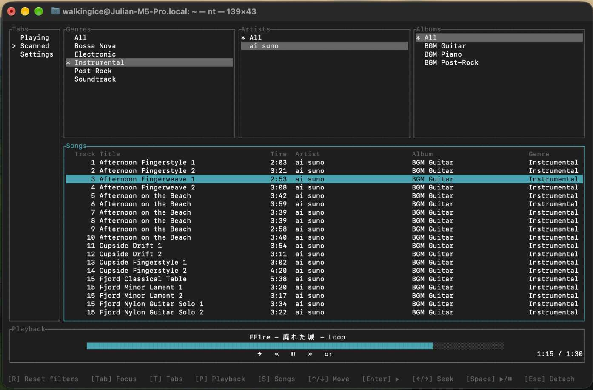
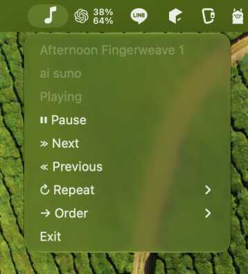

# ngai_tunes

English · [繁體中文](README.zh-TW.md)

**ngai_tunes** is a simple music player for Linux and macOS that supports MP3 and FLAC.

Goals

- Keep the interface minimal and memory use low enough for all-day use.
- Let the server play music in the background so you can close the client to save memory.
- Provide a TUI with plenty of shortcuts for keyboard users.
- Provide a simple menu client for controlling playback from the system menu bar.

Non-goals

- Editing ID3 tags
- Managing music files

## Build

Run the commands below from the repository root with Make, Rust, and Cargo.
macOS uses Core Audio. On Linux, install `pkg-config` and the ALSA development
headers (`libasound2-dev` on Debian and Ubuntu, or `alsa-lib-devel` on Fedora).

Run `make help` to list the available targets.

| Command | Purpose |
| --- | --- |
| `make build` | Build the release binary at `target/release/ngai-tunes`. |
| `make debug` | Build the debug binary at `target/debug/ngai-tunes`. |
| `make menu` | Package the macOS app or build the Linux release binary. See [Menu Client](#menu-client) for setup and launch instructions. |
| `make test` | Run the tests. |
| `make check` | Check all Cargo targets. |
| `make fmt` | Format Rust code. |
| `make fmt-check` | Check Rust formatting. |

These binary paths assume Cargo's default target directory.

## Usage

```sh
$ ngai-tunes               # Attach to the current playback queue
$ ngai-tunes --attach      # Same as above
$ ngai-tunes ~/Music/Jazz  # Browse music files in this directory

# The client normally starts the daemon for you.
$ ngai-tunes --daemon      # Run the daemon in the foreground
$ ngai-tunes --menu        # Open the native menu playback controls
```

The quickest way to get started is to run `ngai-tunes /path/to/music/dir`
and pick a track in Browsing.

For regular use, scan your music directories to build an index, then pick
tracks in Scanned. Run Scan again whenever your music files change.

The configuration and library index are stored in `~/.config/ngai_tunes/`.

### TUI Client



The TUI has three tabs by default. Passing a directory at launch adds a
**Browsing** tab.

- Playing shows the server's playback queue.
- Scanned lists tracks from the library index.
- Settings lets you configure and scan music directories.

Shortcuts are case-sensitive. More shortcuts appear at the bottom of the screen.

- `<Tab>` moves focus.
- `T` focuses Tabs.
- `<Space>` pauses or resumes playback.
- `<Enter>` in Songs sends the displayed song list to the server as the
  **Playing** queue and starts the selected track from the beginning.
- `<Esc>` closes the TUI client. Playback can continue in the background.
- `q` stops playback. If playback is already stopped, it closes the program.

To get started with a scanned library, follow these steps.

1. Run `ngai-tunes` to open the TUI.
1. Press `T` to focus the **Tabs** panel and open **Settings**.
    - Add the paths to your music directories and select **Scan**.
        - The program creates `database.jsonl` in the configuration directory.
1. Press `T` to focus the **Tabs** panel and open **Scanned**.
    - Use `<Tab>` to focus **Genres**, **Artists**, or **Albums**, then
      select a value and press `<Enter>` to apply the filter.
    - Use `<Tab>` to focus **Songs**, then press `<Enter>` on the track you want to play.
        - The client starts the server if needed.
        - The server starts playing the selected track.
        - The displayed song list becomes the server's queue and appears in **Playing**.
1. Press `<Esc>` to close the client while the server continues playing.
1. Run `ngai-tunes` again to return to the TUI.
1. Press `q` to stop playback.
1. Press `q` again or press `<Esc>` to close the TUI client and shut down the server.

When you launch without a directory, the TUI opens Scanned if
`database.jsonl` exists in the configuration directory. Otherwise, it opens
Playing. Playing shows the daemon's queue. If the daemon is offline, the queue
is empty, and a launch without a directory also shows a message at the bottom.

If you pass a directory at launch, use the arrow keys in Browsing to select a
track, then press Enter to load the list into Playing and start the selected
track. Space pauses or resumes playback. Esc closes the client and asks a
stopped daemon to exit. Press `q` while playing or paused to stop playback.
Press it again to close the client and shut down the daemon. With repeat off,
the daemon exits at the end of the queue.

### Menu Client



The menu client complements the TUI client. Once you've picked tracks in the
TUI and sent them to the server, you can use the menu client to control
playback of the current queue. Its controls correspond to the TUI's Playback
panel.

#### Build the macOS menu bar app

Install [cargo-bundle], then run `make menu` from the repository root.
This builds the release binary and packages it as `Ngai Tunes.app`.

```sh
cargo install --locked cargo-bundle --version 0.12.0
make menu
```

To launch the menu client directly from a terminal, run
`cargo run --release -- --menu`.

With Cargo's default target directory, you can open the app in Finder or
run the following command.

```sh
open "target/release/bundle/osx/Ngai Tunes.app"
```

Click the music note in the menu bar to open the playback controls. You can
also move the app into `~/Applications` and use it like any other app.

#### Run the Linux menu client

These steps have yet to be verified.

On Linux, `make menu` builds the release binary. Run
`./target/release/ngai-tunes --menu` in a desktop session with a
StatusNotifierItem host. If the process runs and the icon is missing, use
the following command to check for a host on the session bus.

```sh
busctl --user get-property org.kde.StatusNotifierWatcher /StatusNotifierWatcher \
    org.kde.StatusNotifierWatcher IsStatusNotifierHostRegistered
```

If the service is missing or the command returns `b false`, your desktop
needs a panel or extension that provides a StatusNotifierItem host.

[cargo-bundle]: https://github.com/burtonageo/cargo-bundle

## Development

See the [specification](AGENTS.md) and [architecture](docs/ARCH.md).
