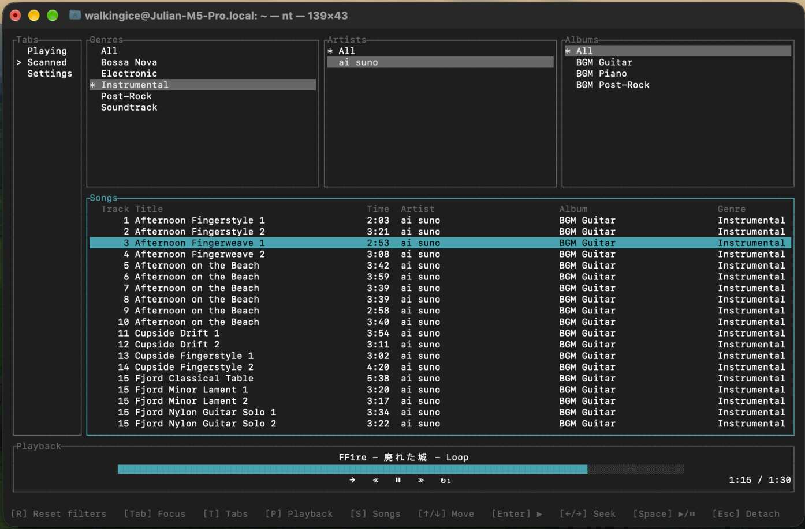
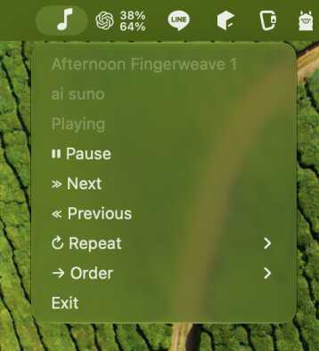

# 介紹

[English](README.md) · 繁體中文

**ngai_tunes** 是一款適用於 Linux 和 macOS 的簡易音樂播放器，支援 MP3 與 FLAC。

目標：
    - 極簡的操作介面，減少記憶體使用量，適合整天使用
    - Client-Server 架構，Server 在背景播放音樂時，可以關閉 Client 減少記憶體用量
    - TUI 介面與豐富的熱鍵，適合熱愛鍵盤操作者
    - 有簡易的 Menu bar client 操縱 Server 的 playback

非目標：
    - ID3 tag 編輯
    - 音樂檔案管理

## 編譯

請在專案根目錄使用 Make、Rust 和 Cargo 執行下列指令macOS 使用 Core Audio。
Linux 需要安裝 `pkg-config` 與 ALSA 開發用標頭檔（Debian 和 Ubuntu 使用
`libasound2-dev`，Fedora 使用 `alsa-lib-devel`）。

執行 `make help` 即可列出可用的目標。

| 指令 | 用途 |
| --- | --- |
| `make build` | 編譯 release 版，執行檔位於 `target/release/ngai-tunes`。 |
| `make debug` | 編譯 debug 版，執行檔位於 `target/debug/ngai-tunes`。 |
| `make menu` | 打包 macOS app 或編譯 Linux release 版。設定與啟動方式請見[選單用戶端](#選單用戶端)。 |
| `make test` | 執行測試。 |
| `make check` | 檢查所有 Cargo 目標。 |
| `make fmt` | 格式化 Rust 程式碼。 |
| `make fmt-check` | 檢查 Rust 程式碼格式。 |

上述執行檔路徑以 Cargo 的預設輸出目錄為準。

## 使用方式

以下是指令簡介

```sh
$ ngai-tunes               # 連線到目前的播放佇列
$ ngai-tunes --attach      # 同上
$ ngai-tunes ~/Music/Jazz  # 播放此目錄內的音樂檔

# 通常不需要使用以下的功能，啟動 daemon 可以交由 client。
$ ngai-tunes --daemon      # 在前景執行 daemon
$ ngai-tunes --menu        # 開啟原生選單的播放控制
```

最簡單的使用方式為 `$ nagi-tunes /path/to/music/dir` 來播放某個目錄底下的檔案

最推薦的方式是先掃描存放音樂檔案的目錄，建立資料索引之後，在 `Scanned` 頁面裡選擇要播放的檔案。
每次音樂檔案有變動時，再次執行 Scan 即可更新索引。

所有設定檔都放在 `~/.local/ngai_tunes/` 之下

### TUI Client



預設有三個 Tab，執行時若指定目錄時會多一個 **Browsing** tab。

- Playing tab：Serve 正在播放的曲目清單，
- Scanned tab：被掃描的資料庫索引的曲目清單
- Settings tab：設定頁面，可以在這邊進行頁面掃描

常用熱鍵(區分大小寫)如下，畫面最下方還有更多熱鍵說明

- `<TAB>`：切換焦點
- `T`： 切換焦點到 Tab
- `<SPACE>`：Pause or Resume 音樂播放
- `<Enter>`：把正在觀看的曲目列表送給 Server (也就是變成 **Playing**)，並從頭播放目前聚焦的曲目
- `<ESC>`：關閉 TUI Client 但是不停止播放
- `q`：暫停播放，或是完全關閉程式

初次使用，建議進行以下步驟

1. 執行 `ngai-tunes` 進入 TUI 介面
1. 按下 `T` 切換焦點到 **Tabs panel**，選擇 **Settings tab**
    - 在裡面新增你存放音樂檔案的路徑，然後按下 **Scan**
        - 程式會在 config 目錄底下，建立 `database.jsonl` 檔案
1. 按下 `T` 切換焦點到 **Tabs panel**，選擇 **Scanned tab**
    - 用 `<Tab>` 切換焦點到上方，在 `Genres` 或 `Artists` panel 裡面選擇你想過濾的條件
    - 用 `<Tab>` 切換焦點到 **Songs panel**，按下 `<Enter>` 決定要播放哪一首
        - Client 會自動啟動 Server
        - Server 開始播放剛剛選擇的音樂
        - 同時當下的歌曲清單會被送到 **Playing** tab 與 server
1. 按下 `<Esc>` 關閉 Client，此時 Server 繼續播放音樂
1. 再次執行 `ngai-tunes` 回到 TUI 介面
1. 按下 `q` 鍵，Server 停止播放
1. 再次按下 `q` 鍵或 `<ESC>`，完全關閉程式
    - 只要離開 TUI 介面時沒有播放音樂，便會自動關閉 Server


。未指定目錄時，如果設定目錄內有 `database.jsonl`，
就會開啟 Scanned，否則會開啟 Playing。Playing 會顯示 daemon 的播放佇列。
如果 daemon 未執行，佇列會是空的。此時若未指定目錄啟動，畫面底部也會顯示提示。

要開始播放，請先指定一個目錄。在 Browsing 分頁用方向鍵選取曲目，按 Enter 將
清單載入 Playing，並從選取的曲目開始播放。按空白鍵可暫停或繼續播放。
按 Esc 可離開用戶端，並要求已手動停止播放的 daemon 結束。播放中或暫停時按
`q` 會停止播放。停止後再按 `q` 會關閉用戶端並結束 daemon。
關閉重複播放時，daemon 會在播完佇列後結束。

### Menu Client



目前 Menu client 僅作為 TUI Client 的輔助。在 TUI Client 裡面翻找出你想聽的曲目，送給 Server 之後。你可以透過 Menu client 對 Server 當時持有的曲目清單，做簡易地操作。換句話說，Menu Client 僅有 TUI Client 裡面的 Playback panel 的功能。

---

編譯 macOS menu app

先安裝 [cargo-bundle]，再從專案根目錄執行 `make menu`。
這會編譯 release 版並打包成 `Ngai Tunes.app`。

```sh
cargo install --locked cargo-bundle --version 0.12.0
make menu
```

接著可以在終端機執行 `cargo run --release -- --menu`，直接啟動選單用戶端。

或著，使用 Cargo 的預設輸出目錄時，可從 Finder 開啟 app，或執行下列指令。

```sh
open "target/release/bundle/osx/Ngai Tunes.app"
```

點選選單列上的音符圖示即可開啟播放控制。當然也可以把這個 App 放進 `~/Applications` 裡面，當成一般的 App。

---

(以下尚未驗證)

執行 Linux 選單用戶端

在 Linux 上，`make menu` 會編譯 release 版。請在提供 StatusNotifierItem host
的桌面工作階段執行 `./target/release/ngai-tunes --menu`。如果程式有執行但圖示
沒有出現，可用下列指令檢查工作階段的 D-Bus 上是否有 host。

```sh
busctl --user get-property org.kde.StatusNotifierWatcher /StatusNotifierWatcher \
    org.kde.StatusNotifierWatcher IsStatusNotifierHostRegistered
```

找不到服務或回傳 `b false` 時，桌面環境需要能提供 StatusNotifierItem host 的
面板或擴充套件。

[cargo-bundle]: https://github.com/burtonageo/cargo-bundle


## 開發

另請參閱[規格](AGENTS.md)和[架構](docs/ARCH.md)。
